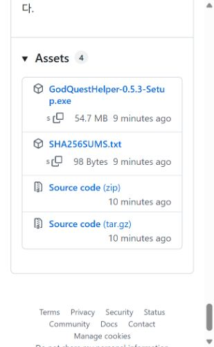
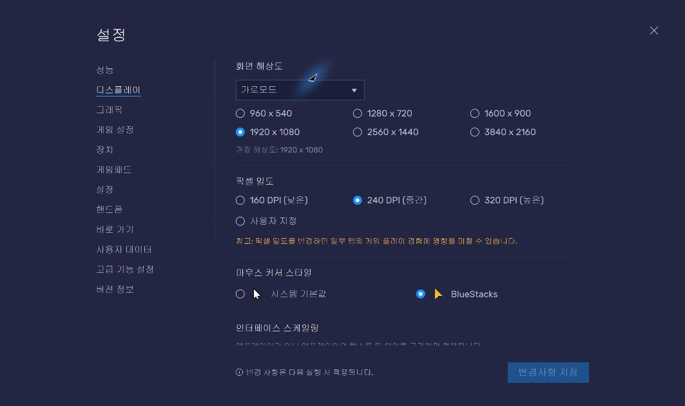
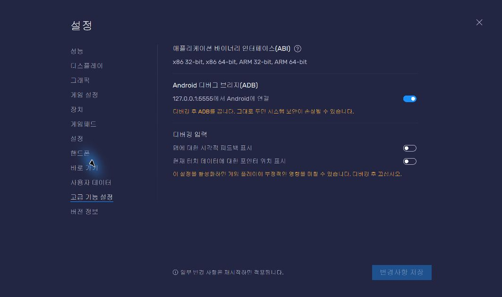
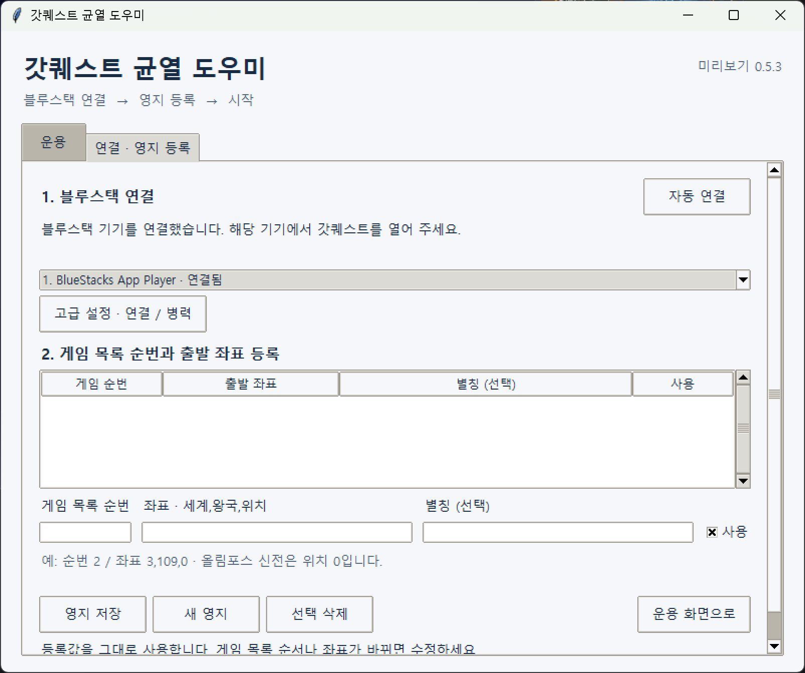
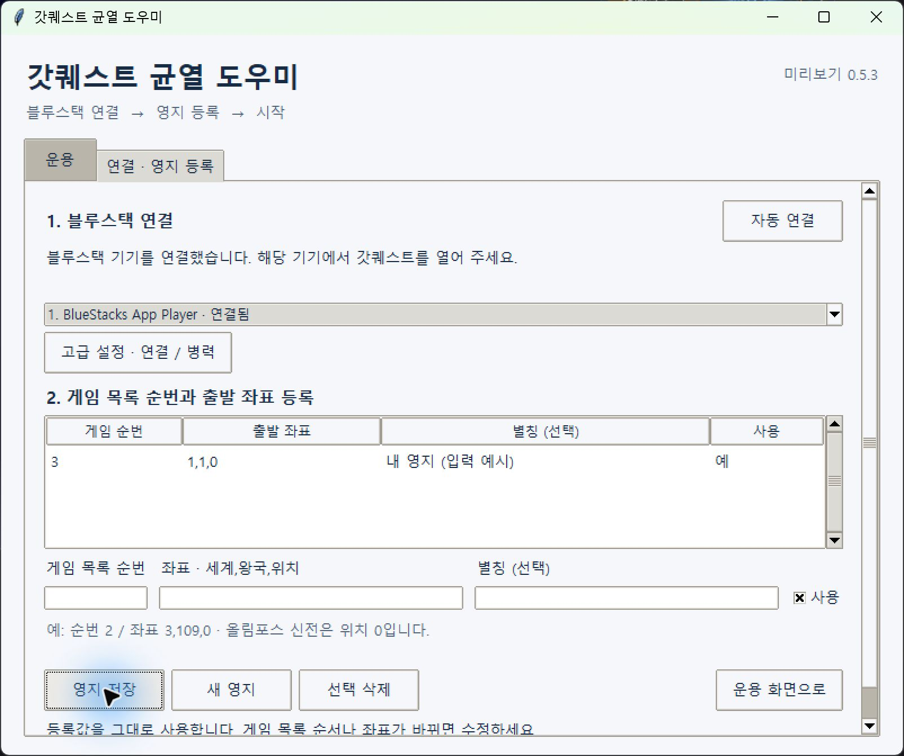
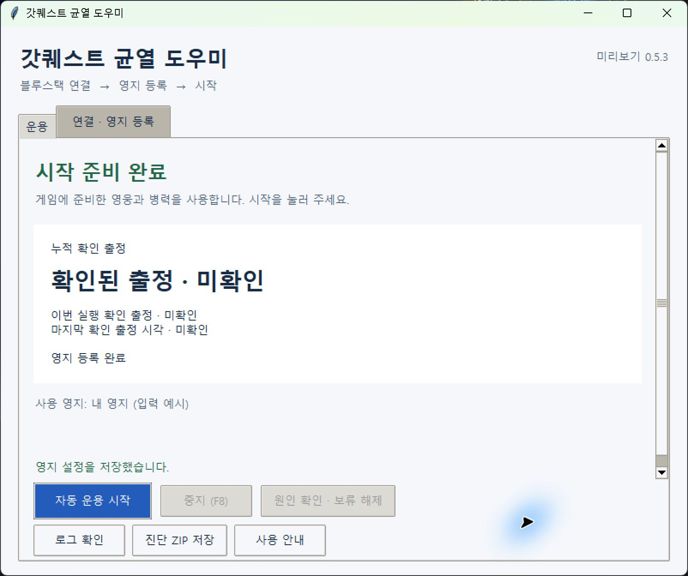

# 갓퀘스트 균열 도우미 · 친구 공유 시험판

Windows x64와 BlueStacks에서 가까운 활성 균열을 찾아 대기 영웅을 보내는 앱입니다. **본인의 영지 순번과 좌표를 등록한 뒤 시작**하면 됩니다. Python·AI 앱·API 키는 따로 필요하지 않습니다.

> 현재 PC에서 0.5.3 설치판의 **설치 → 빈 설정 자동 연결 → 영지 등록 → 신규 출정 3건**을 확인했습니다. 해당 실측의 신규 미확정은 0건, OCR 호출은 0회이며 회귀 검사 1,265개가 통과했습니다. 다른 PC·계정과 24시간 운용은 미검증입니다. [검증 범위](RELEASE-NOTES.ko.md)

## 설치 파일 받기

[Windows x64 설치 파일 — GodQuestHelper-0.5.3-Setup.exe](https://github.com/choihyunjin1/godquest-helper/releases/download/v0.5.3-friends-20261024/GodQuestHelper-0.5.3-Setup.exe)

[사진을 한 장씩 보며 따라 하기](docs/image-app-guide.md) · [GitHub 다운로드 페이지](https://github.com/choihyunjin1/godquest-helper/releases/tag/v0.5.3-friends-20261024)

준비물은 **Windows x64 PC, BlueStacks 5, 로그인한 갓퀘스트, 인터넷 연결**입니다. 앱의 이미지 판단은 PC 안에서 처리하지만 게임 서버 연결은 필요합니다. 휴대전화용 APK는 제공하지 않습니다.

아래는 2026-10-24 실제 화면 사진입니다. **영지 입력 사진의 `3`, `1,1,0`, `내 영지 (입력 예시)`는 설명용 값**이므로 그대로 시작하지 말고 본인 값으로 바꾸세요. 사진을 클릭하면 크게 볼 수 있습니다.

## 1. GitHub에서 Setup.exe 받기

위 설치 파일 링크를 누르면 로그인 없이 다운로드할 수 있습니다. 다운로드 페이지로 들어갔다면 아래 **Assets**를 펼쳐 **GodQuestHelper-0.5.3-Setup.exe**를 누릅니다. <strong>Source code (zip)</strong>이나 **Code → Download ZIP**은 설치 앱이 아닙니다.



## 2. 설치하고 바탕화면에서 열기

다운로드한 `GodQuestHelper-0.5.3-Setup.exe`를 실행하고 설치 마법사를 진행합니다. 완료 화면에서 **마침**을 누른 뒤 바탕화면의 **갓퀘스트 균열 도우미**를 엽니다. BlueStacks를 아직 설치하지 않았다면 다음 단계부터 먼저 진행해도 됩니다.

이 무료 친구 공유 시험판은 **게시자 서명이 없어** Windows 경고나 PC 정책에 따른 차단이 생길 수 있습니다. 차단되면 보호 기능을 끄거나 차단을 우회하지 마세요. 모든 PC에서 경고 없이 실행된다고 보장하지 않습니다.


## 3. BlueStacks에서 게임 준비하기

이미 BlueStacks 5가 있으면 재설치할 필요 없습니다. 없다면 [BlueStacks 공식 다운로드](https://www.bluestacks.com/download.html)에서 받아 설치합니다. BlueStacks 안에서 갓퀘스트를 설치·실행하고 본인 게임 계정으로 로그인합니다.

오른쪽 위 **≡ → 설정 → 디스플레이**에서 <strong>가로모드(16:9)</strong>를 사용합니다. 사진의 **1920×1080, 240 DPI**는 이 PC에서 사용한 예시입니다. 바꿨다면 **변경 사항 저장** 후 BlueStacks가 안내하는 재시작을 마칩니다. PC 사양에 맞는 설정은 [공식 화면 설정 안내](https://support.bluestacks.com/hc/en-us/articles/4402958247949-How-to-change-screen-resolution-on-BlueStacks-5)를 참고하세요.



## 4. BlueStacks의 ADB 켜기

설정 왼쪽 **고급 기능 설정**에서 <strong>Android 디버그 브리지(ADB)</strong>를 켜고 **변경 사항 저장**을 누릅니다. 버전에 따라 메뉴명이 **고급 설정 / Advanced**로 보일 수 있습니다. 아래처럼 파란색이면 켜진 상태입니다. 사진에 나온 주소를 복사할 필요는 없습니다. 앱이 자동으로 찾습니다.



설정을 닫고 게임으로 돌아갑니다. 로그인과 안내 팝업을 마치고 **왕국 지도에서 좌표 입력 버튼이 보이는 상태**로 준비하세요. 영웅과 병력도 게임에서 미리 준비합니다. 고급 병력 입력을 비워 두면 게임의 편성을 유지합니다.

## 5. 앱에서 연결 확인하기

앱의 **연결 · 영지 등록** 탭을 엽니다. 앱은 실행할 때 자동 연결을 시도합니다. 아래처럼 **기기를 연결했습니다 / 연결됨**이면 다시 누를 필요가 없습니다. 연결되지 않았을 때 **자동 연결**을 누르세요. 기기가 여러 개면 실제 게임을 켠 기기를 선택합니다.



**연결 완료는 게임 로그인 완료를 뜻하지 않습니다.** 게임 화면은 4단계처럼 따로 준비하세요. 보통 **고급 설정 · 연결 / 병력**은 열지 않아도 됩니다.

## 6. 본인의 영지 등록하기

게임의 영지 버튼을 누르고 목록을 맨 위로 올립니다. **맨 위가 1번**, 그 아래가 2번입니다. 사용할 영지의 순번과 실제 좌표를 앱에 입력합니다.

| 입력칸 | 넣을 값 |
| --- | --- |
| 게임 목록 순번 | 게임 목록에서 직접 센 순번. 3번째면 `3` |
| 좌표 · 세계,왕국,위치 | 본인 영지의 실제 좌표를 쉼표로 구분 |
| 별칭 (선택) | 본인이 알아볼 이름. 비워도 됨 |
| 사용 | 출발지로 사용할 영지만 체크 |

**영지 저장**을 누르고 아래 사진처럼 **위 목록에 행이 생겼는지** 확인합니다. 한 영지만 쓰려면 그 영지만 등록해 사용하세요. 여러 영지는 **새 영지**로 추가합니다.



세계·왕국은 1 이상, **위치는 0 이상**이며 올림포스 신전 위치 0도 허용합니다. 앱은 입력값을 그대로 신뢰하며 게임 글자와 대조하거나 자동 수정하지 않습니다. 게임 목록 순서나 좌표가 바뀌면 **중지 후 직접 수정·저장**하세요.

## 7. 시작하고 중지하기

**운용 화면으로 → 시작 준비 완료**를 확인한 뒤 **자동 운용 시작**을 누릅니다. 입력만 하고 저장하지 않았다면 먼저 **영지 저장**을 누르세요.



가까운 후보부터 확인하고 실제 활성 균열 그림이 보이면 영주 아래 첫 **선택** 버튼의 대기 영웅을 보냅니다. 이동시간·레벨 입력은 필요 없으며 레벨로 제외하지 않습니다. 대기 영웅이 없으면 10초 간격으로 확인하고 여러 영지는 순환합니다. 파괴된 균열은 건너뛰며 재생성 전에는 보내지 않습니다.

멈추려면 앱의 **중지 (F8)** 버튼을 누르고 작업 표시를 확인하세요. 키보드 F8은 앱이나 보조 창에 초점이 있을 때 동작합니다. 이미 출발한 군대의 이동은 계속됩니다. 운용 중에는 **앱·PC·BlueStacks·게임 연결을 유지**해야 합니다.

사진은 별도의 안내용 설정으로 촬영했고 예시 좌표로 출정하지 않았습니다. 처음에는 출정 횟수가 **미확인**으로 보일 수 있습니다. **확인된 출정 횟수는 균열 파괴 성공 횟수가 아닙니다.**

## 오류가 보이면

| 표시 | 다음 행동 |
| --- | --- |
| 연결 실패 | BlueStacks 실행·ADB·사용 기기를 확인한 뒤 자동 연결 |
| 출정 보류 | **원인 확인 · 보류 해제**에서 원인 화면과 조치 확인. 게임 오류 해결 후 해제 |
| 로그인·알 수 없는 팝업 | 게임에서 직접 처리 |
| 게임 요청 거절 | 원인 해결과 수동 출정 성공 확인 후 해제 |
| 원인 파악이 어려움 | **로그 확인 → 최근 실패 화면 보기**, **진단 ZIP 저장** |

출정 결과가 불명확하면 화면·예약을 보존하고 해당 대상만 제외합니다. 재시작이나 시간 경과로 미확정 시도를 다시 보내지 않습니다. 보류를 해제해도 기존 미확정 예약은 유지됩니다. 진단 ZIP에는 게임 화면·좌표가 들어갈 수 있으므로 공유 전에 확인하세요. 앱은 자료를 자동 전송하지 않습니다.

[사진 13장으로 보는 전체 설치·설정 안내와 오류 설명](docs/image-app-guide.md)

## 개인 설정과 업데이트

배포본에는 개발자의 영지·기기·계정 설정·로그·예약을 포함하지 않습니다. 각자 본인 기기에 연결하고 영지를 등록합니다. 다른 사람의 설정 폴더를 복사하지 마세요. 업데이트에서도 기존 설정·출정 이력·미확정 예약·보류는 보존하며, 기존 등록에 순번이 없으면 직접 입력해야 합니다. 설정 폴더를 삭제해 문제를 해결하지 마세요.

<details>
<summary>설치 파일 확인 정보</summary>

배포 빌드 **20261024-153624-5fcc83**, 파일 크기 **57,405,231바이트**. 로그인 없이 공개 설치 파일을 다시 다운로드해 원본 SHA-256과 일치함을 확인했습니다.

```text
866b6c97df0bfd2f2a26ccc94eda8504d670624bda289320da4122779ea8f13b
```

상세 검증 범위는 [릴리스 안내](RELEASE-NOTES.ko.md)를 확인하세요.

</details>
