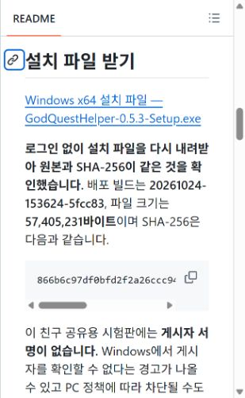
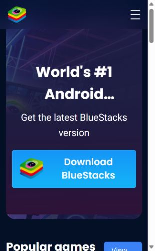
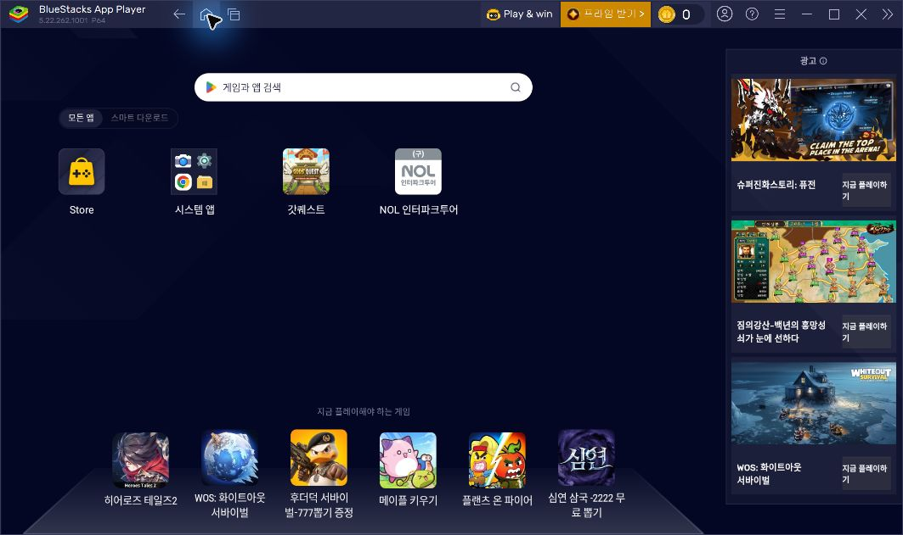
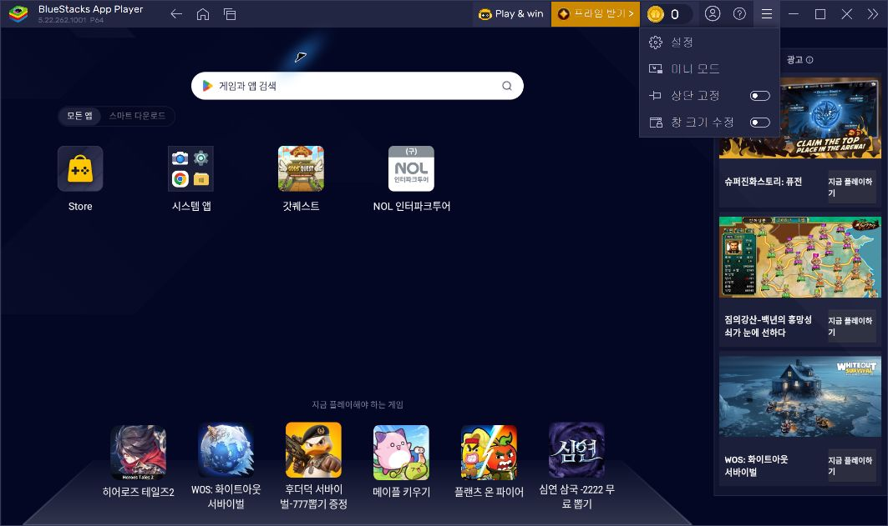
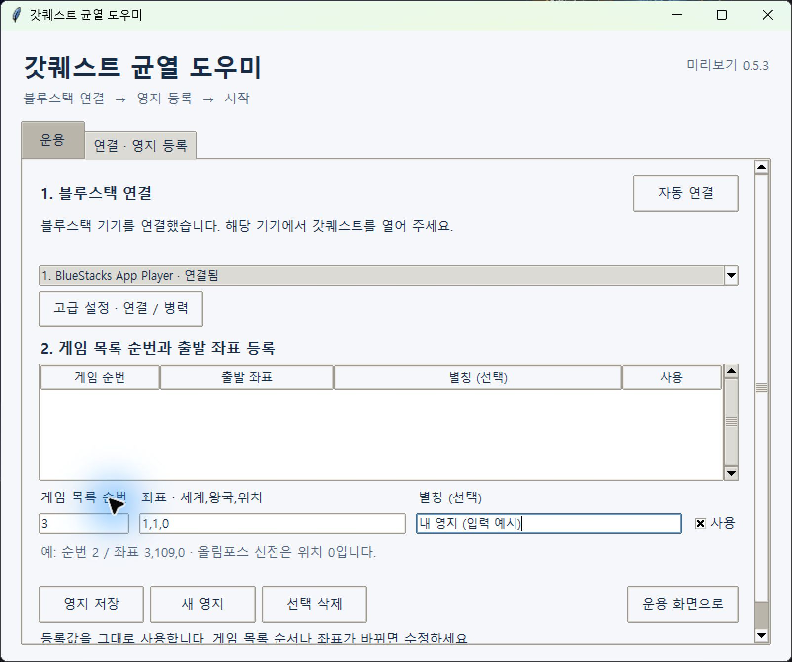
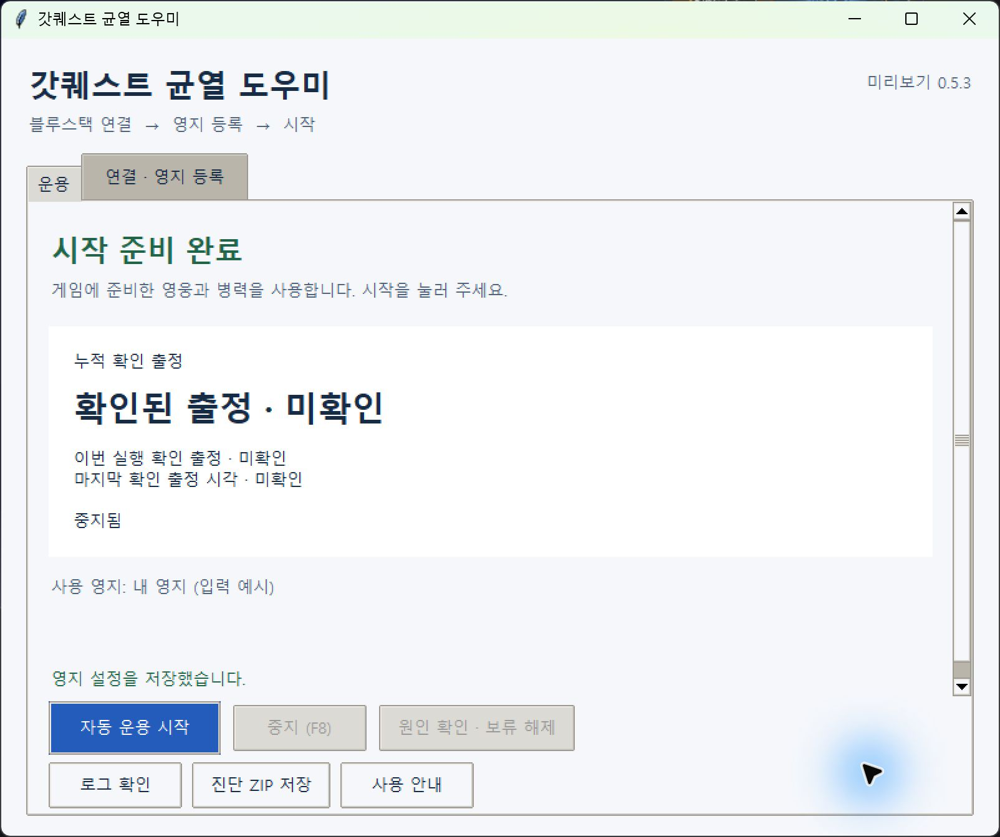

# 사진으로 따라 하는 설치와 첫 설정

[README로 돌아가기](../README.md) · [설치 파일 바로 받기](https://github.com/choihyunjin1/godquest-helper/releases/download/v0.5.3-friends-20261024/GodQuestHelper-0.5.3-Setup.exe)

**다운로드 → 설치 → BlueStacks 준비 → 앱 연결 → 본인 영지 등록 → 시작·중지** 순서입니다. Windows x64 PC, BlueStacks 5, 갓퀘스트 로그인과 인터넷 연결이 필요합니다. Python·AI 앱·API 키는 별도로 필요 없습니다.

기본 흐름의 **13장은 2026-10-24 실제 화면 캡처**입니다. 웹 화면은 창 폭에 따라 배치가 다릅니다. 앱 영지 사진은 별도 안내용 설정에 설명용 값을 입력해 촬영했으며 예시 좌표로 출정하지 않았습니다. 계정 로그인과 비밀번호 화면은 싣지 않았습니다. 사진을 클릭하면 크게 볼 수 있습니다. 맨 아래 오류 예시는 모의 화면으로 따로 표시했습니다.

## 1. GitHub README에서 다운로드 링크 찾기

[저장소 첫 화면](https://github.com/choihyunjin1/godquest-helper)에서 아래로 내려 **설치 파일 받기**를 찾습니다. 파란색 **Windows x64 설치 파일 — GodQuestHelper-0.5.3-Setup.exe** 링크를 누르면 로그인 없이 받습니다.

## 2. Releases에서 받는 경우

[0.5.3 다운로드 페이지](https://github.com/choihyunjin1/godquest-helper/releases/tag/v0.5.3-friends-20261024)에서 아래로 내려 **Assets**를 펼칩니다. 첫 번째 **GodQuestHelper-0.5.3-Setup.exe**를 누릅니다. **SHA256SUMS.txt**는 확인용 파일이고 **Source code (zip/tar.gz)**은 설치 앱이 아닙니다. 저장소의 **Code → Download ZIP**도 설치용이 아닙니다.

## 3. 설치 완료 후 앱 열기

다운로드한 Setup.exe를 실행해 설치 마법사를 진행합니다. 설치 완료 화면에서 **마침**을 누릅니다. 바탕화면의 **갓퀘스트 균열 도우미** 바로가기로 다시 열 수 있습니다.

**게시자 서명이 없는 무료 친구 공유 시험판**입니다. Windows 경고나 PC 정책에 따른 차단이 생길 수 있으며, 차단되면 보호 기능을 끄거나 차단을 우회하지 마세요.

이 사진은 빌드 **20261024-153624-5fcc83**을 현재 PC에 실제 설치한 완료 화면입니다. 다른 PC·계정과 24시간 운용은 아직 검증하지 않았습니다. [검증 범위](release-notes.md)

## 4. BlueStacks 5 받기

이미 BlueStacks 5가 있으면 5단계로 넘어갑니다. 없으면 [BlueStacks 공식 다운로드](https://www.bluestacks.com/download.html)에서 **Download BlueStacks**를 눌러 설치합니다. 다른 사이트의 재배포 설치 파일은 사용하지 마세요. 설치 과정의 세부 화면은 [공식 설치 안내](https://support.bluestacks.com/hc/en-us/articles/360061525271-How-to-download-and-install-BlueStacks-5)를 참고하세요.

## 5. BlueStacks에서 갓퀘스트 설치·로그인

BlueStacks 안에서 갓퀘스트를 설치하고 실행합니다. Google 계정과 게임 계정 로그인은 본인이 진행합니다. 아래는 갓퀘스트 아이콘이 있는 실제 BlueStacks 홈입니다. 계정·비밀번호 화면은 안내 사진에 포함하지 않았습니다.

## 6. BlueStacks 설정 열기

오른쪽 위 **≡ → 설정**을 누릅니다. 버전에 따라 오른쪽 도구 모음의 톱니바퀴로 열 수도 있습니다.

## 7. 가로 화면 설정

왼쪽 **디스플레이 → 가로모드(16:9)**를 확인합니다. 사진의 **1920×1080, 240 DPI**는 이 PC의 설정 예시입니다. 바꿨다면 **변경 사항 저장**을 누르고 BlueStacks의 재시작 안내를 따릅니다. 모든 설정을 사진과 똑같이 바꿀 필요는 없습니다. [공식 화면 설정 안내](https://support.bluestacks.com/hc/en-us/articles/4402958247949-How-to-change-screen-resolution-on-BlueStacks-5)

## 8. Android 디버그 브리지(ADB) 켜기

왼쪽 **고급 기능 설정 → Android 디버그 브리지(ADB)**를 켜고 **변경 사항 저장**을 누릅니다. 버전에 따라 **고급 설정 / Advanced**라고 표시됩니다. 사진은 이미 켜져 있어 저장 버튼이 비활성인 상태입니다. 아래 주소·포트는 PC마다 다를 수 있으므로 복사하지 않습니다. 앱이 자동으로 찾습니다. [공식 ADB 설정 안내](https://support.bluestacks.com/hc/en-us/articles/23925869130381-How-to-enable-Android-Debug-Bridge-on-BlueStacks-5)

설정을 닫고 갓퀘스트로 돌아갑니다. 로그인과 안내 팝업을 마친 뒤 **왕국 지도에서 좌표 입력 버튼이 보이는 상태**로 준비합니다. 사용할 영웅과 병력도 게임에서 준비하세요. 병력 고급 설정을 비워 두면 게임의 편성을 유지합니다.

## 9. 앱에서 자동 연결 확인

바탕화면 바로가기로 도우미를 열고 **연결 · 영지 등록** 탭을 봅니다. 실행 직후 자동 연결을 시도합니다. **기기를 연결했습니다 / 연결됨**이면 다음 단계로 갑니다. 그렇지 않으면 **자동 연결**을 누릅니다. 기기가 여러 개면 갓퀘스트를 켠 기기를 선택하세요.

기기 연결과 게임 로그인은 별개입니다. 연결돼 있어도 게임은 8단계처럼 준비해야 합니다. **고급 설정 · 연결 / 병력**은 자동 연결이 안 되거나 병력을 직접 지정할 때만 사용하며 기본 설정에서는 건너뜁니다.

## 10. 영지 순번과 실제 좌표 입력

게임에서 영지 버튼을 누르고 목록을 맨 위로 올립니다. **첫 영지가 1번**입니다. 사용할 영지가 세 번째면 앱 **게임 목록 순번**에 `3`을 넣습니다. **좌표 · 세계,왕국,위치**에는 본인의 실제 출발 좌표를 쉼표로 구분해 입력합니다. **별칭**은 선택 사항입니다. 사용할 영지만 **사용**을 체크합니다.

아래 `3`, `1,1,0`, `내 영지 (입력 예시)`는 설명용입니다. **그대로 시작하지 말고 본인 순번과 좌표를 입력하세요.** 세계·왕국은 1 이상, 위치는 **0 이상**으로 올림포스 신전 위치 0도 가능합니다. 이동시간과 레벨은 입력하지 않습니다.

## 11. 영지 저장과 목록 반영 확인

**영지 저장**을 누릅니다. 위 표에 **게임 순번·출발 좌표·별칭·사용=예** 행이 나타나는지 확인하세요. 저장 후 아래 입력칸이 비워지는 것은 정상입니다. 추가는 **새 영지**, 수정은 표에서 해당 행을 선택해 진행합니다. 한 영지만 쓰려면 그 영지만 등록하고 사용하세요.

앱은 사용자 입력을 그대로 신뢰합니다. 게임의 이름이나 좌표를 OCR로 읽어 대조·자동 수정하지 않습니다. 게임 목록 순서나 좌표가 바뀌면 **중지 후 직접 수정·저장**해야 합니다.

## 12. 자동 운용 시작

**운용 화면으로**를 누릅니다. **시작 준비 완료**와 사용할 영지 별칭을 확인하고 **자동 운용 시작**을 누릅니다. 미저장 입력이 남았다면 먼저 저장하거나 지웁니다.

이 사진에서는 예시 좌표로 출정하지 않았습니다. **미확인**은 아직 출정 기록을 확인하지 않은 상태입니다. 확인된 출정 횟수는 균열 파괴 성공 횟수가 아닙니다.

앱은 가까운 후보에서 실제 활성 그림을 확인한 뒤 영주 아래 첫 **선택** 버튼으로 대기 영웅을 배정합니다. 목록 전체를 먼저 훑거나 레벨로 영웅을 제외하지 않습니다. 대기 영웅이 없으면 10초마다 확인하고 여러 영지는 순환합니다. 파괴된 균열은 건너뛰며 재생성 전에는 보내지 않습니다.

## 13. 중지와 다시 시작

운용 중 앱의 **중지 (F8)** 버튼을 누르고 작업이 **중지 중 / 중지됨**으로 바뀌는지 확인합니다. 키보드 F8은 앱이나 보조 창에 초점이 있어야 합니다. 아래는 출정을 실행하지 않은 안내용 창에서 F8을 눌러 **중지됨** 표시를 확인한 실제 사진입니다. 운용 중인 군대가 귀환한 증거는 아닙니다.

이미 출발한 군대의 게임 내 이동은 계속됩니다. 다시 운용하려면 게임과 연결 상태를 확인한 뒤 **자동 운용 시작**을 누릅니다. 운용 중에는 **앱·PC·BlueStacks·게임 연결을 유지**하세요.

## 문제가 생겼을 때

**연결 실패**면 BlueStacks와 ADB를 확인하고 자동 연결을 다시 시도합니다. **출정 보류**면 **원인 확인 · 보류 해제**로 당시 화면과 필요한 조치를 확인합니다. 게임 요청 거절은 원인 해결과 수동 출정 성공 확인 후 해제하세요. 로그인과 알 수 없는 팝업은 게임에서 직접 처리합니다.

**로그 확인 → 최근 실패 화면 보기**, **진단 ZIP 저장**으로 원인 자료를 모을 수 있습니다. 진단 ZIP에는 화면·좌표가 포함될 수 있으므로 공유 전 확인하세요. 앱은 자동 전송하지 않습니다. 미확정 예약은 재시작·시간 경과·보류 해제만으로 삭제하거나 재전송하지 않습니다.

---

아래는 **2026-10-09 설명용 모의 오류 화면**입니다. 위 13장의 실제 기본 설정 사진과 구분하세요. 오류·복구 성공을 실측한 증거가 아닙니다.

## 오류 예시 · 출정 보류

**출정 보류**가 보이면 **원인 확인 · 보류 해제**를 누릅니다. 당시 화면과 다음 조치를 확인하고 게임에서 원인을 처리합니다. 로그인·알 수 없는 팝업은 직접 처리하며, 게임 요청 거절은 수동 출정 성공을 확인한 뒤 해제합니다. 보류를 해제해도 기존 미확정 예약은 남고 자동 재전송하지 않습니다.

아래 원인 이미지도 설명을 위해 만든 그림입니다. 실제 오류에서는 저장된 게임 화면을 표시합니다. 원인 화면을 저장하지 못했으면 그 사유를 안내하고 보류를 유지합니다. 화면이 없다는 이유로 출정을 반복하지 않습니다.

## 오류 예시 · 로그와 진단 ZIP

**로그 확인**에서 실패 단계·마지막 입력·분류·처리 결과와 반복 횟수를 확인합니다. **최근 실패 화면 보기**에서는 최신 실패에 연결된 화면을 확인합니다. 최신 화면이 없거나 읽지 못하면 그 사유를 표시하며 이전 사건 화면으로 대신하지 않습니다. 이 버튼은 아래 설명 사진 이후에 추가됐습니다.

**설정·로그 경로 복사**로 현재 사용 중인 실제 보관 경로를 복사할 수 있습니다. **진단 ZIP 저장**은 자료를 본인 PC에 저장합니다. 게임 캡처와 좌표가 포함될 수 있으므로 공유 전에 확인하세요. 앱은 자료를 자동 전송하지 않습니다.

## 오류 예시 · 설정을 읽지 못할 때

**설정 확인 필요**가 보이면 **설정 백업 복원** 또는 **설정 새로 등록**을 선택하고 안내를 따릅니다. 설정을 새로 등록해도 원본과 백업, 출정 이력·예약·게임 보류는 보존합니다. 다른 사람의 설정 폴더를 복사하거나 미확정 예약을 삭제해 문제를 넘기지 마세요.

아래는 읽을 수 없는 설정을 일부러 만든 설명용 화면입니다. 실제 복원 성공 사진은 아닙니다.

기본 순서를 다시 보려면 앱의 **사용 안내**를 누릅니다. 더 자세한 내용은 설치 폴더의 **QUICKSTART.ko.md**를 확인하세요.
