# 사진으로 시작하는 갓퀘스트 균열 도우미

기본 순서는 **블루스택 연결 → 영지 등록 → 시작**입니다. 설치판은 별도 Python·AI 앱·API 키 없이 사용하도록 묶습니다. BlueStacks에서 게임에 로그인하고 가로 16:9 화면으로 준비한 뒤 ADB를 켭니다. 게임 서버 인터넷 연결은 필요합니다.

**2026-10-24 실제 설치 완료·빈 설정 자동 연결 사진 2장**과 **2026-10-09 설명용 모의 화면 9장**을 구분해 실었습니다. 각 사진의 설명을 확인하세요. 모의 화면의 연결 결과·등록값·오류는 안내를 위해 만든 자료이며 이번 설치판의 실제 출정·복구 증거가 아닙니다. 실제 빌드와 검증 범위는 [릴리스 안내](release-notes.md)를 확인하세요.

## 0. 설치하기

GitHub Releases에서 `GodQuestHelper-0.5.3-Setup.exe`를 받아 실행합니다. **Source code (zip)**과 **Code → Download ZIP**은 설치 앱이 아닙니다. 현재 GitHub 게시 준비 중이며 게시·다운로드 확인이 끝나기 전까지 README의 링크는 예정 주소입니다.

이 친구 공유용 시험판에는 게시자 서명이 없어 Windows에서 게시자 확인 경고가 나올 수 있습니다. PC 정책으로 실행이 차단되면 보호 기능을 끄거나 차단을 우회하지 마세요. 설치가 끝나면 바탕화면의 **갓퀘스트 균열 도우미**를 엽니다.

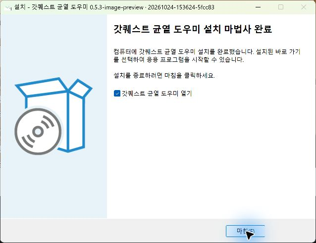

위 사진은 빌드 **20261024-153624-5fcc83**을 현재 PC에 실제 설치해 촬영한 완료 화면입니다. 이번 설치판은 자동 연결·영지 등록 후 신규 출정 3건을 확인했고 회귀 검사 1,265개가 모두 통과했습니다. 다른 PC·계정과 24시간 운용은 미검증이며, 자세한 범위는 [릴리스 안내](release-notes.md)를 확인하세요.

## 1. 블루스택 연결

BlueStacks에서 게임을 준비한 뒤 앱의 **연결 · 영지 등록** 탭을 엽니다. **자동 연결**을 누르고 사용할 기기를 선택합니다. 찾지 못하면 게임 로그인과 BlueStacks의 Android 디버그 브리지(ADB)가 켜져 있는지 확인합니다. ADB 경로·주소의 수동 입력은 **고급 설정 · 연결 / 병력**에 있습니다.

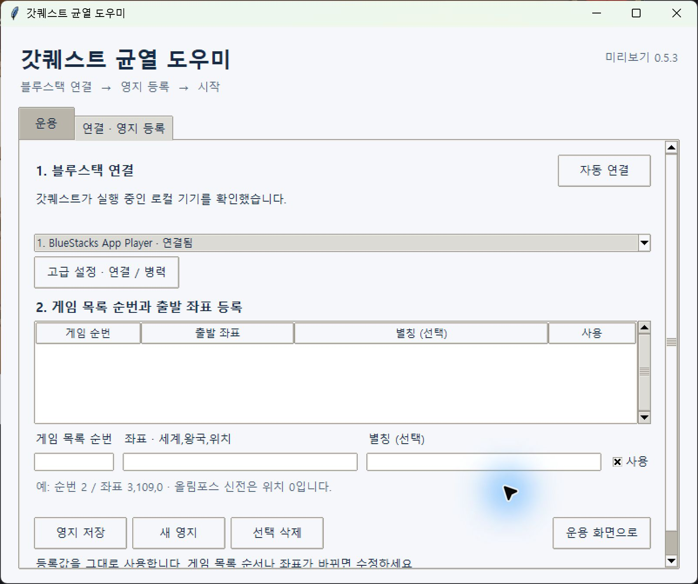

위 사진은 이번 설치판의 빈 설정에서 ADB 경로를 직접 입력하지 않고 자동 연결한 실제 화면입니다. 영지 목록과 입력란은 아직 비어 있으며, 아래부터 본인의 게임 목록 순번과 좌표를 등록하면 됩니다.

아래는 이전에 만든 **모의 연결 설명 예시**입니다. 위 실제 연결 사진과 구분해 보세요.

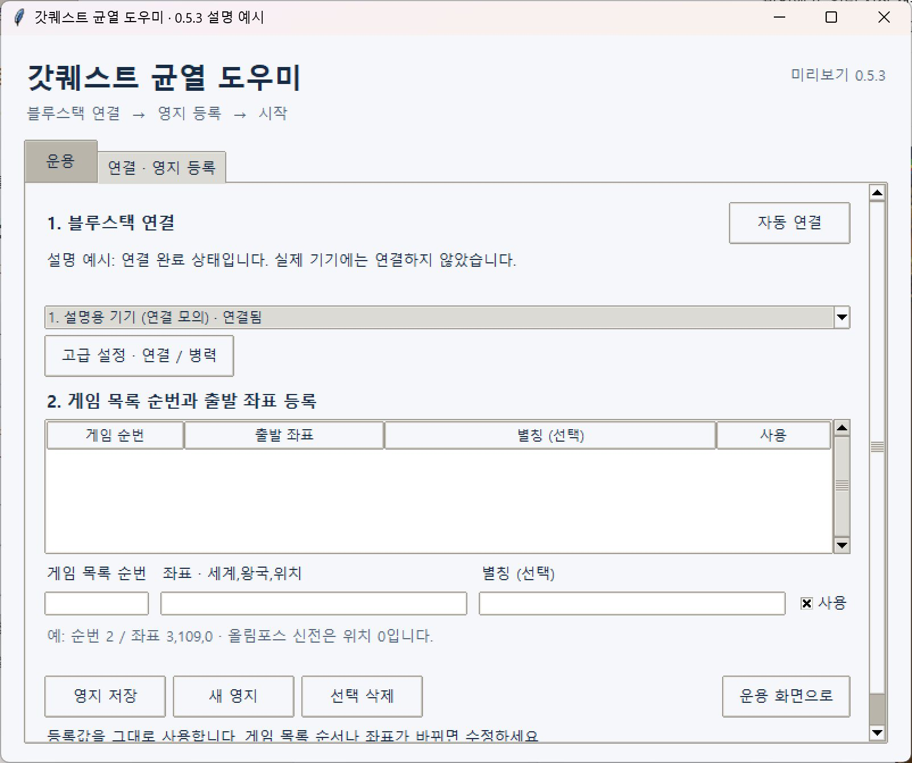

## 2. 게임 목록 순번과 좌표 등록

1. 게임 영지 목록을 맨 위부터 셉니다. 세 번째 영지는 **게임 목록 순번**에 `3`을 입력합니다.
2. **좌표 · 세계,왕국,위치**에 실제 출발 좌표를 입력합니다. 별칭은 비워도 됩니다.
3. 사용할 영지는 **사용**을 체크하고 **영지 저장**을 누릅니다. 저장한 행이 위 목록에 나타납니다.
4. 추가 등록은 **새 영지**, 수정은 위 목록에서 해당 행 선택으로 시작합니다.

세계·왕국은 1 이상, 위치는 **0 이상**입니다. 올림포스 신전의 위치 0도 허용합니다. 아래 사진의 `3번`, `1,1,0`, `내 영지 (입력 예시)`는 설명용이므로 본인 값으로 바꾸세요.

앱은 등록값을 그대로 사용합니다. 게임 글자와 대조하거나 자동 수정하지 않습니다. 목록 순서나 좌표가 바뀌면 중지 후 수정하세요. 입력한 뒤 **영지 저장**을 누르지 않았으면 시작 전에 저장하거나 입력을 비워야 합니다. 작은 창에서는 스크롤하거나 Tab으로 입력란을 이동할 수 있습니다.

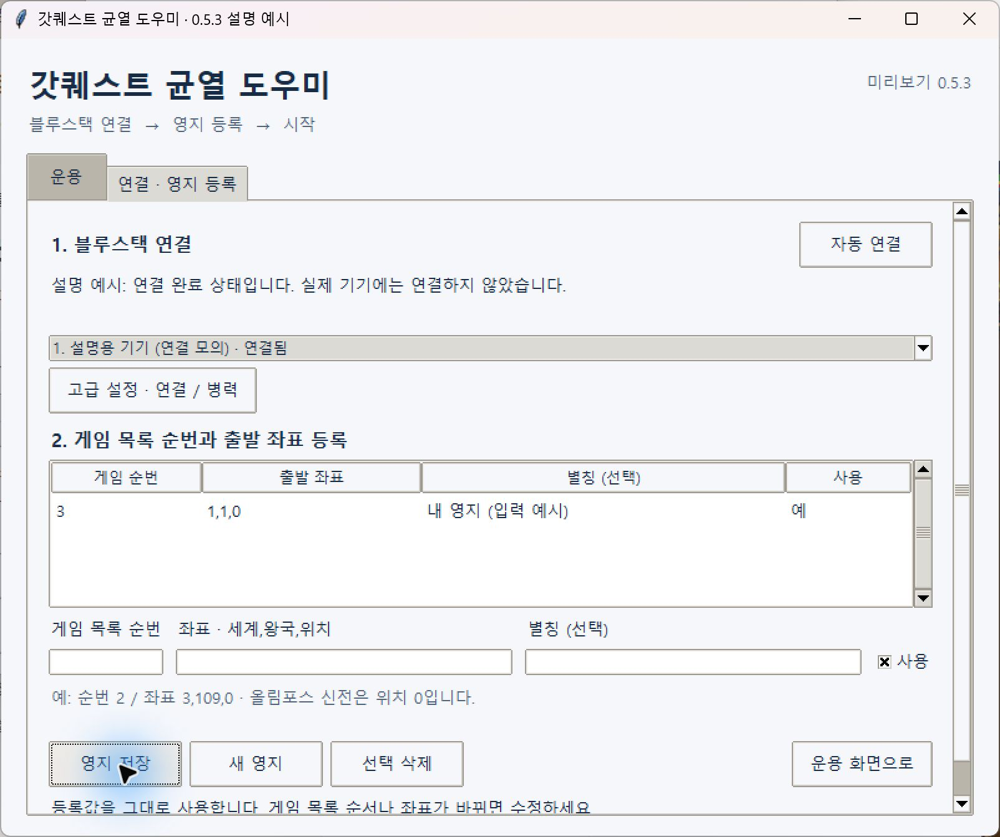

## 3. 영웅과 병력 준비

병력은 게임에서 미리 준비합니다. **고급 설정 · 연결 / 병력**의 병력 입력이 비어 있으면 준비한 병력을 유지합니다. 앱에서 따로 지정하려면 먼저 해당 영지를 선택하고 `병종=수량`을 한 줄씩 입력한 뒤 **저장**합니다. 이동시간·레벨 입력은 필요 없습니다.

영주 아래 화면에 보이는 첫 **선택** 버튼으로 대기 영웅을 바로 배정합니다. 두 번째 칸에 선택 가능한 영웅이 있으면 그 영웅을 쓰며 목록 전체를 먼저 훑지 않습니다. 아래로 스크롤된 빈 화면일 때만 목록을 올립니다. 대기 영웅이 없으면 10초마다 확인합니다.

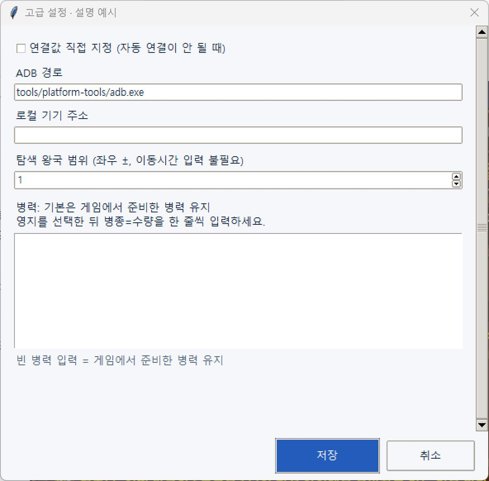

## 4. 시작과 중지

**운용** 탭에서 **자동 운용 시작**을 누릅니다. 연결·영지 등록이 안 됐거나 게임 오류 보류 중이면 화면에 사유를 표시합니다. 앱은 가까운 활성 균열을 탐색하며 파괴된 균열은 건너뜁니다. 활성 그림을 확인한 뒤에만 보내며 재생성 전 출정은 하지 않습니다.

**확인된 출정 횟수는 균열 파괴 성공 횟수가 아닙니다.** 출정 기록을 아직 읽지 못한 경우에는 미확인으로 표시하며, 읽기에 실패하면 마지막으로 확인한 수를 유지합니다. 아래 `0회`는 출정을 실행하지 않은 설명용 상태입니다.

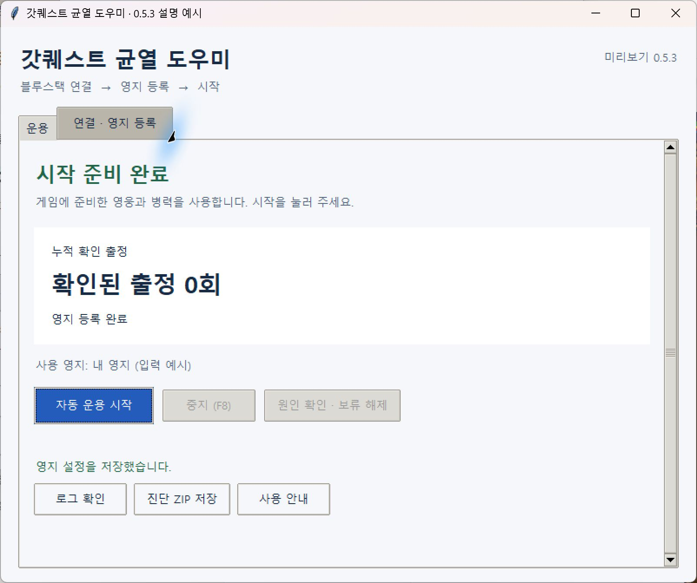

멈추려면 **중지 (F8)**를 누릅니다. F8은 앱이나 보조 창에 초점이 있을 때 동작하며 작업에 **중지 중** 또는 **중지됨**이 표시됩니다. 이미 출발한 군대의 게임 내 이동은 계속됩니다. 앱·PC·BlueStacks가 켜져 있고 게임 서버에 연결되어 있어야 운용됩니다.

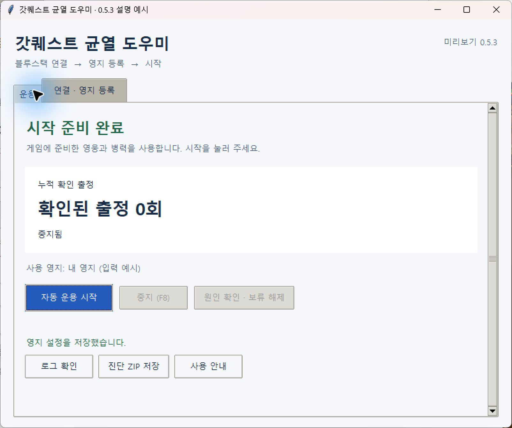

## 5. 오류 원인 확인

**출정 보류**가 보이면 **원인 확인 · 보류 해제**를 누릅니다. 당시 화면과 다음 조치를 확인하고 게임에서 원인을 처리합니다. 로그인·알 수 없는 팝업은 직접 처리하며, 게임 요청 거절은 수동 출정 성공을 확인한 뒤 해제합니다. 보류를 해제해도 기존 미확정 예약은 남고 자동 재전송하지 않습니다.

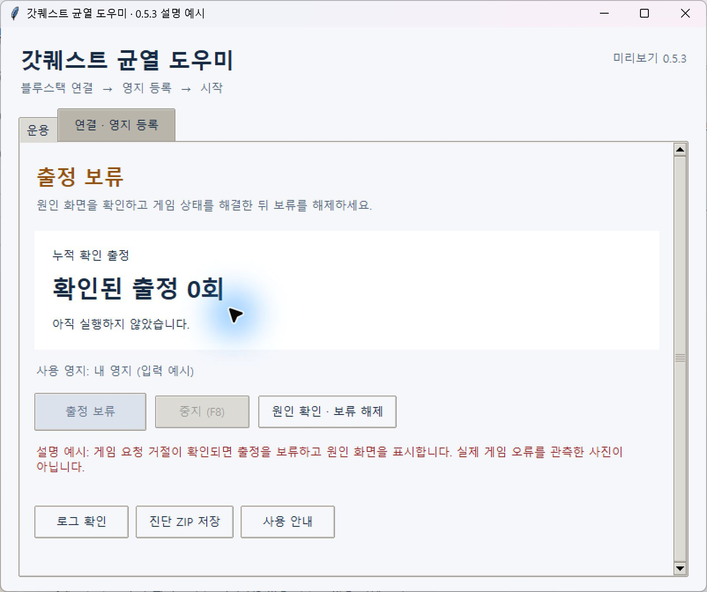

아래 원인 이미지도 설명을 위해 만든 그림입니다. 실제 오류에서는 저장된 게임 화면을 표시합니다. 원인 화면을 저장하지 못했으면 그 사유를 안내하고 보류를 유지합니다. 화면이 없다는 이유로 출정을 반복하지 않습니다.

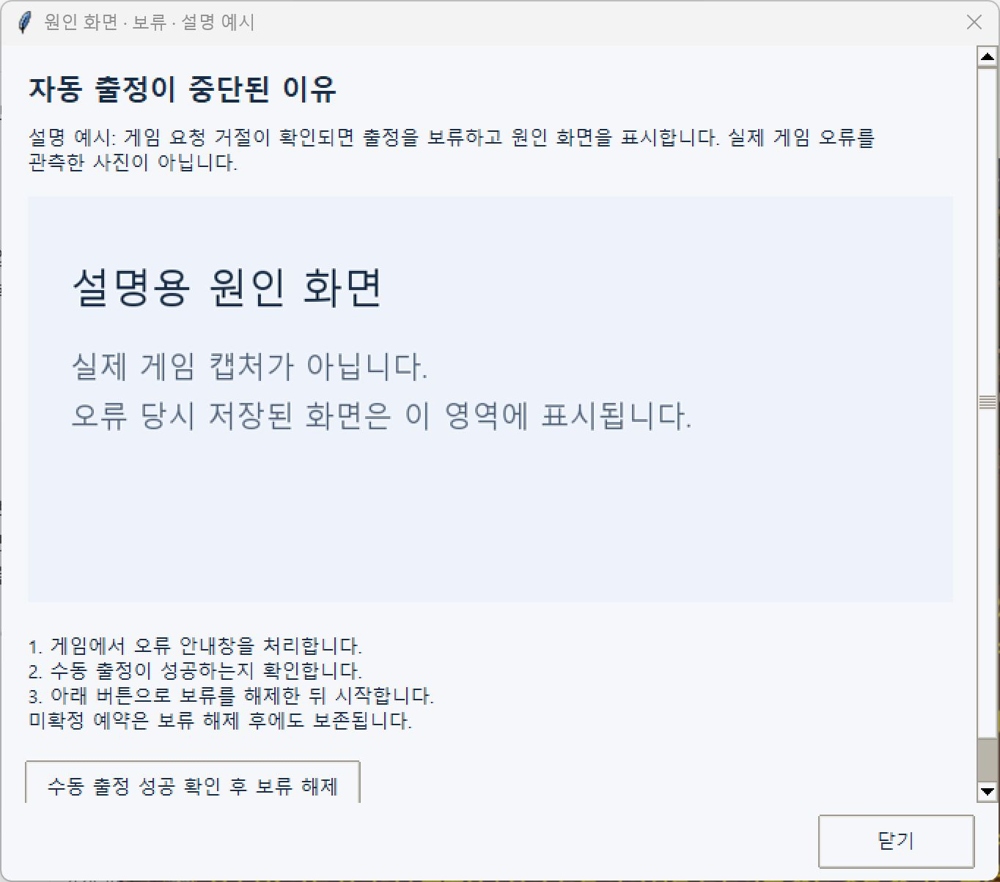

## 6. 로그와 진단 ZIP

**로그 확인**에서 실패 단계·마지막 입력·분류·처리 결과와 반복 횟수를 확인합니다. **최근 실패 화면 보기**에서는 최신 실패에 연결된 화면을 확인합니다. 최신 화면이 없거나 읽지 못하면 그 사유를 표시하며 이전 사건 화면으로 대신하지 않습니다. 이 버튼은 아래 설명 사진 이후에 추가됐습니다.

**설정·로그 경로 복사**로 현재 사용 중인 실제 보관 경로를 복사할 수 있습니다. **진단 ZIP 저장**은 자료를 본인 PC에 저장합니다. 게임 캡처와 좌표가 포함될 수 있으므로 공유 전에 확인하세요. 앱은 자료를 자동 전송하지 않습니다.

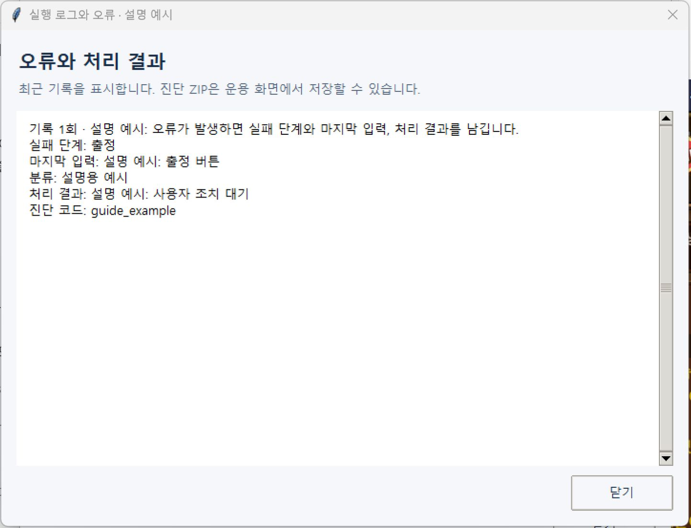

## 7. 설정을 읽지 못할 때

**설정 확인 필요**가 보이면 **설정 백업 복원** 또는 **설정 새로 등록**을 선택하고 안내를 따릅니다. 설정을 새로 등록해도 원본과 백업, 출정 이력·예약·게임 보류는 보존합니다. 다른 사람의 설정 폴더를 복사하거나 미확정 예약을 삭제해 문제를 넘기지 마세요.

아래는 읽을 수 없는 설정을 일부러 만든 설명용 화면입니다. 실제 복원 성공 사진은 아닙니다.

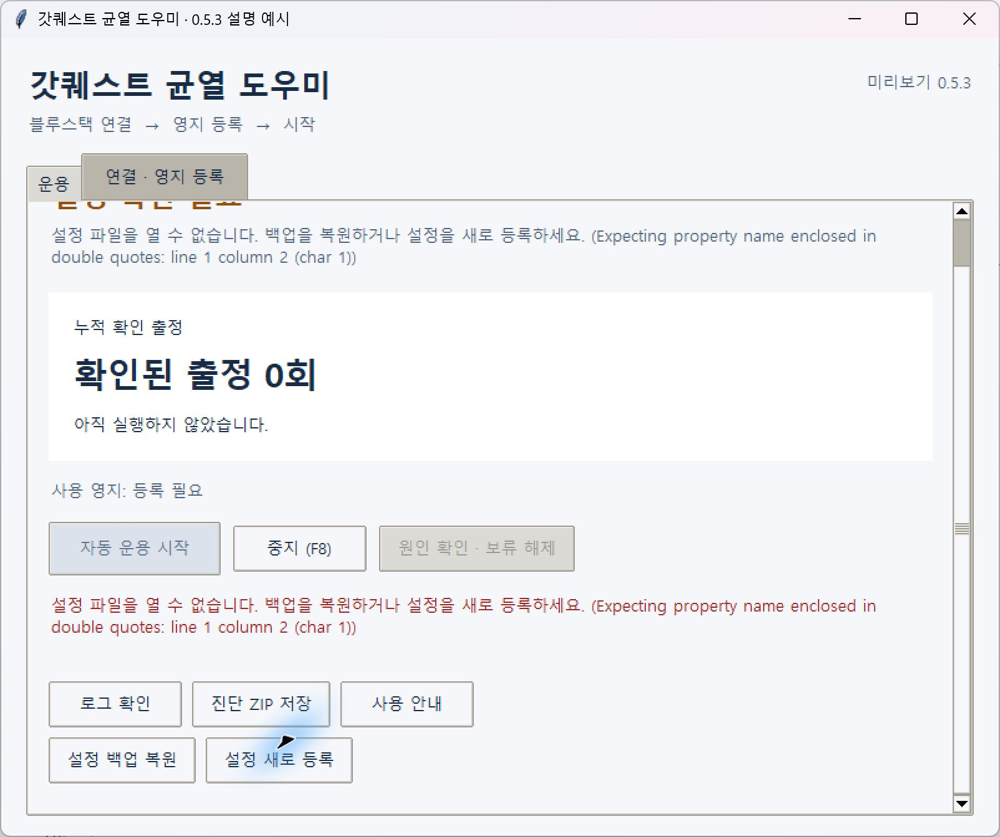

기본 순서를 다시 보려면 앱의 **사용 안내**를 누릅니다. 더 자세한 내용은 설치 폴더의 **QUICKSTART.ko.md**를 확인하세요.
